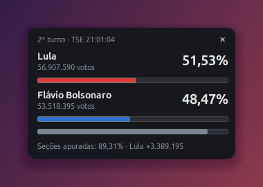
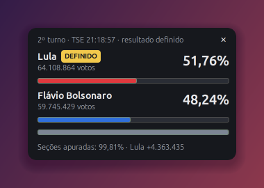

# 🗳️ Apuração 2026 — widget de desktop

Um widget pequeno, que fica sempre por cima das outras janelas, para acompanhar **ao vivo** a apuração do 2º turno presidencial de 2026 (**Lula × Flávio Bolsonaro**) direto na área de trabalho. Sem abrir o navegador e sem atualizar a página a cada minuto.

Os números vêm dos **arquivos oficiais do TSE**, os mesmos que alimentam o site de resultados do tribunal, e são atualizados sozinhos a cada 30 segundos.

<p align="center">
  
  &nbsp;
  
</p>

<p align="center"><sub>À esquerda, a apuração às 21:01, com 89,31% das seções. À direita, às 21:18, com o resultado já matematicamente definido pelo TSE.</sub></p>

## O que ele mostra

- **Percentual de votos válidos** de cada candidato, com uma barra na cor de cada um
- **Total de votos** de cada candidato
- **Seções apuradas** e a **diferença de votos** entre o primeiro e o segundo
- Selo **DEFINIDO** quando o TSE marca o resultado como matematicamente definido, e **ELEITO** quando o candidato é declarado eleito na totalização
- **Hora da última totalização** do TSE

## Como funciona

O TSE não oferece uma API REST formal. Ele publica **arquivos JSON estáticos** em `resultados.tse.jus.br`, documentados nas especificações técnicas de divulgação. O widget lê o arquivo do 2º turno presidencial:

```
https://resultados.tse.jus.br/oficial/ele2026/6258/dados/br/br-c0001-e006258-u.json
```

| Trecho do caminho | Significado |
|---|---|
| `ele2026` | ciclo eleitoral 2026 |
| `6258` | código da eleição: *Eleição Ordinária Federal 2026, 2º Turno* |
| `br` | abrangência nacional |
| `c0001` | cargo 1, Presidente |

O código da eleição vem do arquivo de configuração `ele-c.json`, que lista todas as eleições do ciclo. Em 2026 o formato mudou em relação a 2022, e o caminho antigo (`dados-simplificados/...-r.json`) não existe mais para este turno.

## Instalação

Requer Linux com GNOME (testado no Ubuntu 26.04) e Python 3 com GTK 3, que já vêm instalados no Ubuntu. Não há dependências extras.

```bash
git clone https://github.com/FlavioGabriel2030/widget-eleicoes-2026.git
cd widget-eleicoes-2026
./instalar.sh
```

Depois, procure **"Apuração 2026"** no menu de aplicativos, ou rode direto:

```bash
~/.local/bin/widget-eleicoes.py
```

## Como usar

- **Mover:** clique e arraste em qualquer parte do widget
- **Fechar:** clique no **✕**
- Ele abre no canto superior direito e fica sempre por cima das outras janelas

## Desinstalar

O widget foi feito para ser descartável. Para tirá-lo, basta apagar dois arquivos:

```bash
rm ~/.local/bin/widget-eleicoes.py ~/.local/share/applications/widget-eleicoes.desktop
```

## Links do TSE

- 🌐 [Resultados oficiais, site do TSE](https://resultados.tse.jus.br)
- 📄 [Arquivo JSON usado pelo widget (2º turno, Presidente)](https://resultados.tse.jus.br/oficial/ele2026/6258/dados/br/br-c0001-e006258-u.json)
- ⚙️ [Configuração das eleições, `ele-c.json`](https://resultados.tse.jus.br/oficial/comum/config/ele-c.json)
- 📘 [Informações técnicas sobre a divulgação de resultados](https://www.tse.jus.br/eleicoes/informacoes-tecnicas-sobre-a-divulgacao-de-resultados)
- 📘 [Divulgação dos resultados das eleições](https://www.tse.jus.br/eleicoes/processo-eleitoral-brasileiro/divulgacao-de-resultados/divulgacao-dos-resultados-das-eleicoes)
- 📘 [EA11, especificação do arquivo de configuração de eleições (2026)](https://www.tse.jus.br/eleicoes/eleicoes-2026-content/arquivos/divulgacao-de-resultados/tse-ea11-arquivo-de-configuracao-de-eleicoes)

## Aviso

Este é um projeto pessoal e **não oficial**, sem vínculo com o TSE. Os dados exibidos são lidos diretamente dos arquivos públicos do tribunal. Para o resultado oficial, consulte sempre o [site do TSE](https://resultados.tse.jus.br).
